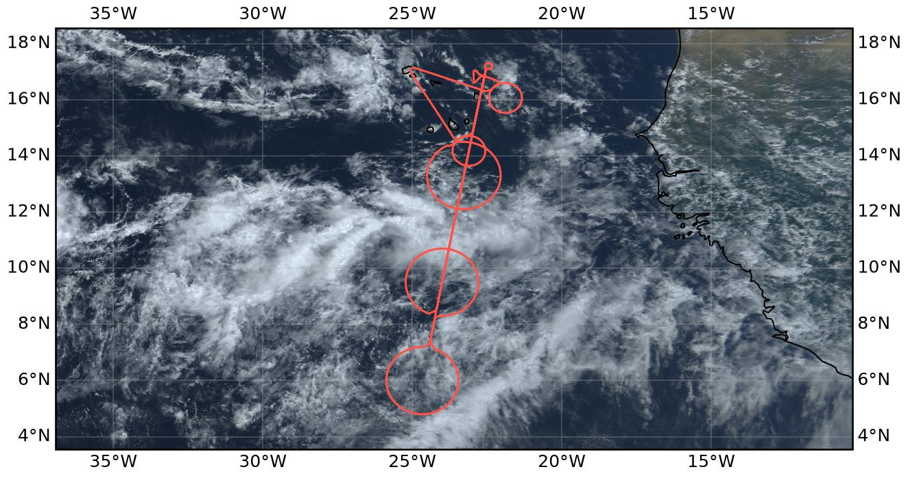
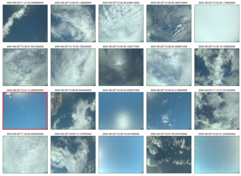

{logo}`PERCUSION`

# {front}`flight_id`

```{badges}
```

## Crew

```{crew-list}
```

## Track


## Conditions

```{track-animation}
:flight_id: HALO-20240822a
```


On 22 August 2024, the ITCZ over the eastern tropical Atlantic was characterized by a relatively broad region of enhanced atmospheric moisture extending approximately between 6°N and 14°N. The forecast column water vapour field showed a continuous moist band with pronounced meridional moisture gradients towards both its northern and southern boundaries. The southernmost circle was located near the southern moisture gradient, while the central and northern circles sampled the more humid part of the ITCZ.

Satellite imagery revealed a heterogeneous distribution of convection within this moist region. Several clusters of deep convection with extensive upper-level cloud shields were concentrated primarily between approximately 7°N and 11°N, forming a fragmented, roughly east–west-oriented convective band. During the afternoon, individual convective systems evolved and their associated anvil clouds spread over larger areas, particularly west of the flight track. Farther north, towards Cabo Verde, cloud cover was considerably more broken, with scattered shallow clouds, patches of higher-level clouds, and extensive cloud-free regions.

The southern circle sampled the southern transition of the convective region, with extended cloud shields nearby and less organized cloudiness farther south. The central circle was dominated by optically thick anvil cirrus at altitudes of approximately 11–13 km, with additional cloud layers around 6 km, as observed by the airborne lidar. Strong attenuation within the upper cloud layer frequently prevented observations of the underlying cloud structure. The northern circle sampled the transition towards shallower, more scattered cloud fields. Overall, deep convection was organized into several distinct cloud clusters rather than a single continuous convective system.

## Execution

The flight was designed to investigate the apparent broadening of the ITCZ, which had presented itself as a comparatively narrow band during the previous day's flight. The broader column water vapour field and the more complex, multi-banded cloud structure made the placement of the dropsonde circles particularly challenging. The northern circle was constrained by the proximity of the Cabo Verde islands to the northern edge of the ITCZ, while the southern circle had to be positioned between the southern ITCZ boundary and an  even further southern, bifurcating branch of the ITCZ.

The flight plan called for the southernmost dropsonde circle (C_South), centered at 6°N, to be flown first, followed by the central circle (C_Mid) at 9°30′N. Near C_South, the first direct overflight of RV Meteor during this campaign was planned. Following C_Mid and a short northward excursion beyond Sal, a coordinated aerosol measurement leg with the ATR-42 and King Air was planned along the EarthCARE track east of Praia. This was to be followed by a smaller circle (C_ATR1) around the ATR-42 operating area and subsequently the northern dropsonde circle (C_North). For the return leg, an overpass of the Mindelo ground station was planned, followed by a second coordination with the ATR-42. This final measurement pattern consisted of a circle (C_ATR2) around the ATR-42's second operating area east of Sal, before returning to the airport.

Takeoff was delayed by approximately 15 minutes due to the late arrival of the fuel truck. However, since the original flight plan included a 15-minute holding pattern after C_South, the delay could be absorbed without affecting the subsequent coordination with the ATR-42, King Air, and the scheduled EarthCARE overpass. RV Meteor was approximately 20 NM behind its planned position but was nevertheless able to sample both the entry and exit regions of C_South with its S-POL radar. Dropsonde operations were largely successful, with 12 sondes deployed in each of C_South and C_Mid, and another 10 in C_ATR1. In C_North, two of the 12 planned dropsonde positions were missed. Nevertheless, the spatial coverage of the northern region was considered sufficient due to the partial overlap between C_ATR1 and C_North, although this overlap had initially raised some concerns. The overpass of the Mindelo ground station was completed as planned. Subsequently, the second coordination with the ATR-42 was successfully carried out during its afternoon flight in C_ATR2, before HALO returned to Sal.

Altogether we coordinated with four platforms: EarthCARE, Meteor, the KingAir and the ATR-42.  

## Impressions

- 10:56: Small delay due to a late fuel truck - T/O planned some minutes after 1010LT
- 11:08: Allowed to T/O in front of Antonov
- 11:29: Had to take-off towards the south due to cross-winds. We are currently 15 mins behind schedule but have a buffer of around 15 mins in C_South
- 12:12: Nice outflows visible from here, going to enter the convective line in some minutes
- 12:21: Quite smooth ride here, mostly in cirrus
- 12:30: Exiting the convective line, thin cirrus around
- 12:50: Dropping our first dropsonde close to Meteor at the 12 o'clock position of C_South
- 13:00: Multiple broken strato decks below in C_South, no elevated convection, just some small Cu embedded in the lower marine strato deck
- 13:01: The cirrus band further south of us was not forecasted like that in IFS
- 13:04: Nice showers out of the few Cu with tops at 6km and melting layer at 5km - probably too weak to be picture up by S-POL
- 13:34: Just cut the cirrus deck in our southern circle at its 5 oclock position some minutes ago
- 13:36: Stratocumulus deck at 6 km is almost 8/8 now
- 13:46: Leaving C_South with a close flyby over Meteor
- 14:16: Getting a little bit bumpy, just like the first transect through the ITCZ line. Seems like gravity waves emitted southwards
- 14:22: Deep convection below us with heavy rain
- 14:40: Multiple cirrus layers below us - still bumpy
- 14:42: Two broken Stratodecks below @ 5 km and 2 km, lower one with embedded convection
- 15:44: Spotted ATR-42 below our common flight leg
- 15:48: Not much other things in the radar though but nice lidar leg apperently :-)
- 17:02: Climbing to FL400 for C_North
- 17:23: IWV from KV at 48 kg/m2 at the northern tip of C_North, increasing now to 65 kg/m2.
- 17:47: Nice drizzling marine strato layer at 5 km, completely evaporating in the dry layer before reaching ground
- 18:02: Now heading to the Mindelo overpass
- 18:25: A very shallow layer above Mindelo, just at the sensitivity limit of our radar
- 18:40: Flying C_ATR2 clockwise - just completed a radar calibration before decending to FL350
- 18:58: Small convective cell with a longer cirrus outflow tail with its top almost at FL350
- 19:06: Just cut it on its SE corner with tops of 1.8-2.5 km and reflectivities of 20 dBZ with rain on the ground. Did not cut the deepest part, a lot of detached cirrus around
- 19:10: Some nice convection at the 10 o'clock position of C_ATR2
- 19:17: Last dropsonde, finished C_ATR2
- 19:34: Preparing for landing


```{note}
Co-location with ATR-42, KingAir and EarthCARE over an aerosol layer near SAL.
```

````{card-carousel} 2

```{card}
:img-top: ../figures/HALO-20240822a/2024-08-22T1016.jpeg

Our crew before the flight (PI Camera, 1016 UTC)
```

```{card}
:img-top: ../figures/HALO-20240822a/2024-08-22T1125.jpeg

Interesting sand features on Sal after departure (F Ewald, 1125 UTC)
```

```{card}
:img-top: ../figures/HALO-20240822a/2024-08-22T1228.jpeg

Cross-cutting the ITCZ with our radar on our way south (F Ewald, 1228 UTC)
```

```{card}
:img-top: ../figures/HALO-20240822a/2024-08-22T1303.jpeg

Altocumulus in C_South and the bifurcating branch of the ITCZ in the back (Pi Camera, 1303 UTC)
``` 

```{card}
:img-top: ../figures/HALO-20240822a/2024-08-22T1323.jpeg

Meeting with RV Meteor in C_South (F Ewald, 1323 UTC)
```


```{card}
:img-top: ../figures/HALO-20240822a/2024-08-22T1410.jpeg

Altostratus in C_Mid and the main ITCZ branch in the back (F Ewald, 1410 UTC)
```


```{card}
:img-top: ../figures/HALO-20240822a/2024-08-22T1539.jpeg

Flying along the ATR-42 track below the EarthCARE overpass (F Ewald, 1539 UTC)
```


```{card}
:img-top: ../figures/HALO-20240822a/2024-08-22T1555.jpeg

Aerosol situation during the EarthCARE overpass (PI Camera, 1555 UTC)
```

```{card}
:img-top: ../figures/HALO-20240822a/2024-08-22T1750.jpeg

Some scattered congestus and their stratodecks in C_north  (F Ewald, 1750 UTC)
```

```{card}
:img-top: ../figures/HALO-20240822a/2024-08-22T1807.jpeg

Stratocumulus in the lee of the island Brava towards Mindelo (F Ewald, 1809 UTC)
```

```{card}
:img-top: ../figures/HALO-20240822a/2024-08-22T1825.jpeg

Cloud situation over Mindelo (PI Camera, 1825 UTC)
```


```{card}
:img-top: ../figures/HALO-20240822a/2024-08-22T1847.jpeg

Decaying convection close to C_ATR2 (F Ewald, 1847 UTC)
```

```{card}
:img-top: ../figures/HALO-20240822a/2024-08-22T1903.jpeg

Some remaining altostratus and low cirrus in C_ATR2 (F Ewald, 1903 UTC)
```

````

## Instrument status & quicklooks

```{instrument-table}
```
````{card-carousel} 2

```{card}
:img-top: ../figures/HALO-20240822a/HALO_20240822a_BACARDI_QL.png
BACARDI: Time series.
```

```{card}
:img-top: ../figures/HALO-20240822a/hamp_fullflight_HALO-20240822a.png
HAMP 
```

```{card}
:img-top: ../figures/HALO-20240822a/hamp_ec_under_HALO-20240822a.png
HAMP during EarthCARE underpass
```

```{card}
:img-top: ../figures/HALO-20240822a/hamp_radar_ec_under_HALO-20240822a.png
Radar during EarthCARE underpass
```

```{card}
:img-top: ../figures/HALO-20240822a/HALO_20240822a_KT19_QL.png
KT19 Timeseries of brigthness temperature.
```

```{card}
:img-top: ../figures/HALO-20240822a/HALO_20240822a_SMART_QL.png
SMART Time series of upward and downward spectral irradiadiance, and albedo.
```

```{card}
[](https://www.meteorologie.lmu.de/~quicklooks/specMACS/PERCUSION/quicklooks/polcams/quicklook_20240822_polb.png)
specMACS RGB snapshots from polb (lower right) with EarthCARE underpass marked in red. Find further quicklooks [here](https://www.meteorologie.lmu.de/~quicklooks/specMACS/PERCUSION/flight_HALO-0822.html).
```

```{card}
:img-top: ../figures/HALO-20240822a/QL_VELOX_HALO_20240822a.jpg
VELOX broadband channel with EC underpass
```

```{card}
:img-top: ../figures/HALO-20240822a/HALO-20240822-wales-ec.png
WALES (backscatter, polarization and humidity) at EC overpass
```

```{card}
:img-top: ../figures/HALO-20240822a/0822-wales-3d.jpg
WALES (3D backscatter)
```

```{card}
:img-top: ../figures/HALO-20240822a/0822-wales-x.png
WALES (cross section)
```
````
